# Project C — Pinball

**A stylized 3D pinball combat prototype built in Unity.**

The ball is your weapon. Launch into the arena, chain ricochets, use flippers to return the ball, and dash into enemies while defending your base. Toy-like characters bring distinct attack patterns to the board, with procedural animation and real-time deformation that make their movement and impacts readable.

**Engine:** Unity 6000.5.0f1 · **Rendering:** Universal Render Pipeline · **Status:** In development

> **Personal project · In active development · Private source**
>
> This showcase presents the game's current gameplay, characters, and visual systems. As a personal project still in development, its source code, Unity project files, and original game assets are not available for public sharing.

[Gameplay](#gameplay) · [Deformation & animation](#deformation--procedural-animation) · [Enemy roster](#enemy-roster) · [Dreamwalker](#boss--dreamwalker) · [Controls](#controls) · [Source access](#source-code-access) · [Development history](#development-history)

## At a glance

| Area | What the project includes |
| --- | --- |
| **Pinball combat** | Charged launches, ricochets, flipper returns, targeted dashes, and base defense |
| **Procedural animation** | Attack anticipation, recoil, flight, teleport transitions, and secondary motion |
| **Real-time deformation** | Local impact dents, squash and stretch, directional recoil, and elastic recovery |
| **Characters & encounters** | Nine enemy designs, including melee attackers, mobile ranged enemies, and pillow guards; a Dreamwalker boss encounter |
| **Development tools** | Character previews, deformation authoring, tuning profiles, gameplay checks, and performance tools |

## Gameplay

**Launch → ricochet → return or dash → keep the base safe.** Enemies attack while you keep the ball in play. Bumper contacts build Rush, and combat combos increase damage.

<p align="center">
  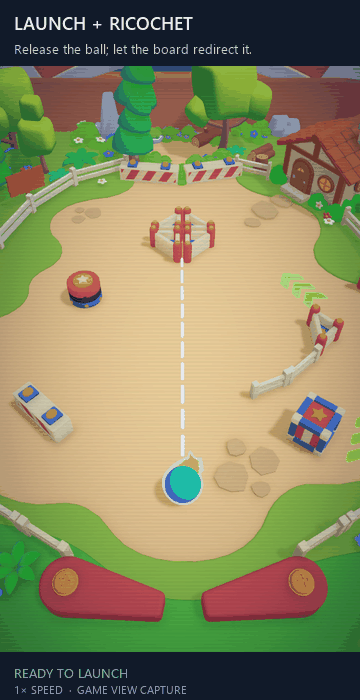
  <br><sub><strong>Launch and ricochet.</strong> Follow the ball from release through its first contacts with the board.</sub>
</p>

<p align="center">
  <strong>Return the ball with a flipper</strong><br>
  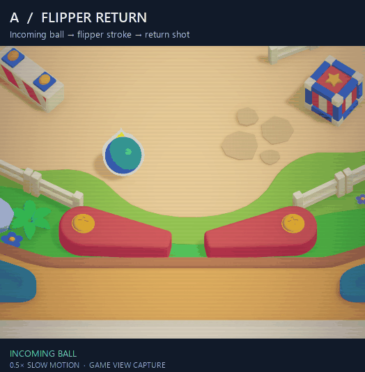<br>
  <sub>Incoming ball → press <strong>A</strong> → return shot. Shown at 0.5× speed.</sub>
</p>

<p align="center">
  <strong>Commit to a targeted dash</strong><br>
  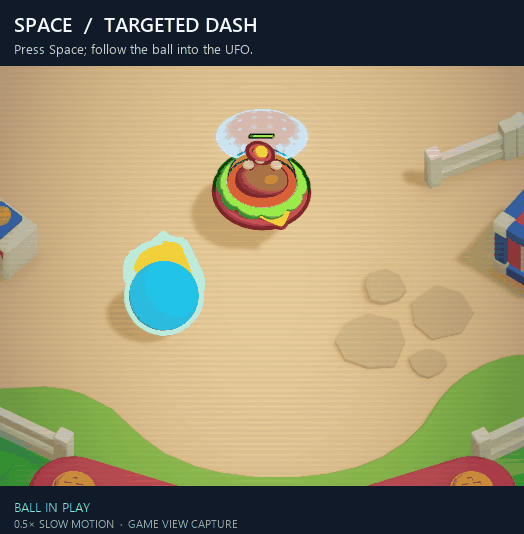<br>
  <sub>Press <strong>Space</strong> → dash windup → contact with Burger UFO. Shown at 0.5× speed.</sub>
</p>

<sub>Gameplay GIFs are recorded from Unity's Game View in controlled gameplay setups, including the project's post-processing and scanline overlay. On-screen captions identify each action and result; slow-motion clips are labeled.</sub>

## Deformation & procedural animation

Character motion has two complementary layers. **Procedural animation** gives each action a clear rhythm: anticipation before an attack, recoil on release, and settling afterward. Wings, hats, tails, and other flexible parts add secondary motion.

**Real-time deformation** lets visible meshes dent, compress, stretch, and wobble in response to impacts. SoftMotion drives these visual responses while gameplay controls collision shapes, damage, and movement. For example, Puddle Puffer's air jet moves the enemy across the board; inflation, deflation, and recovery communicate that action visually.

<p align="center">
  <strong>Impact, deformation, recovery</strong><br>
  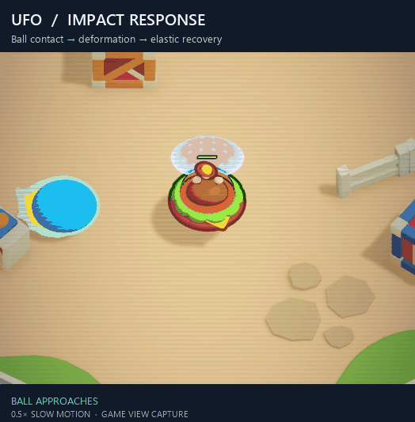<br>
  <sub><strong>Burger UFO:</strong> ball contact → directional deformation → elastic recovery. Shown at 0.5× speed.</sub>
</p>

<p align="center">
  <strong>A hit becomes an air jet</strong><br>
  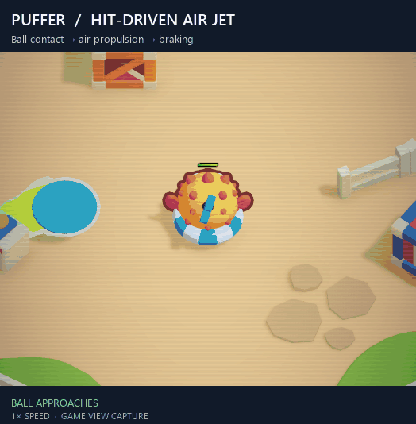<br>
  <sub><strong>Puddle Puffer:</strong> impact → pressure buildup → air propulsion → recovery. The camera follows the enemy.</sub>
</p>

## Enemy roster

Lookdev portraits of the nine current enemy designs. Rounded forms, clear silhouettes, and soft motion establish the project's toy-like visual style.

<table align="center">
  <tr>
    <td align="center" width="33%">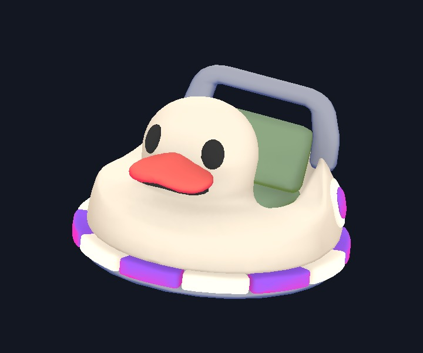<br><strong>Duck Pod</strong><br><sub>Ground melee · peck and lunge</sub></td>
    <td align="center" width="33%">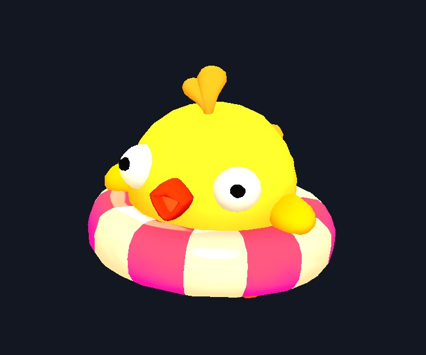<br><strong>Oops Chick</strong><br><sub>Ranged pressure · wind-up and recoil</sub></td>
    <td align="center" width="33%">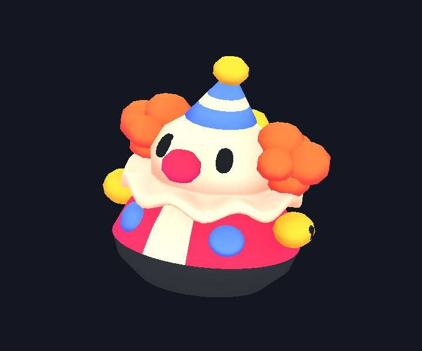<br><strong>Roly Clown</strong><br><sub>Ranged attacker · teleport repositioning</sub></td>
  </tr>
  <tr>
    <td align="center">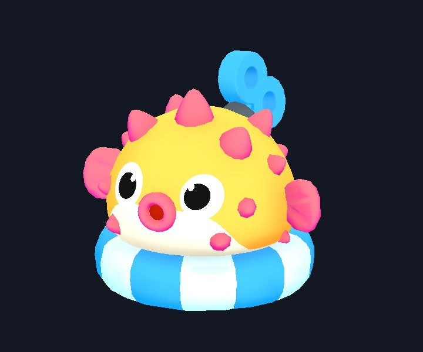<br><strong>Puddle Puffer</strong><br><sub>Air-jet movement · inflation and recovery</sub></td>
    <td align="center">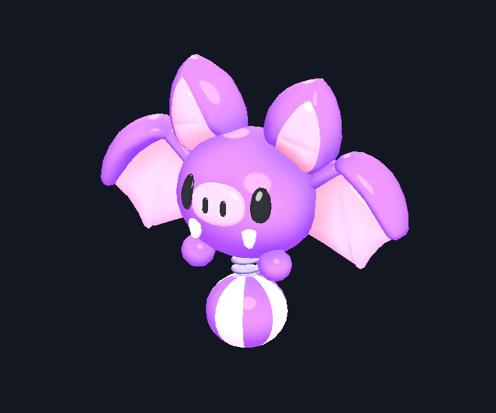<br><strong>Batloon</strong><br><sub>Flying ranged attacker · relocation</sub></td>
    <td align="center">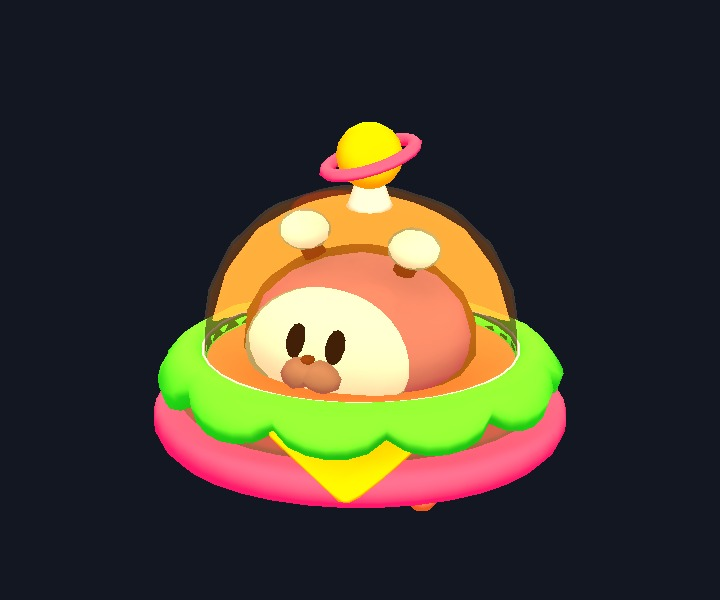<br><strong>Burger UFO</strong><br><sub>Hovering melee · elastic impact response</sub></td>
  </tr>
  <tr>
    <td align="center">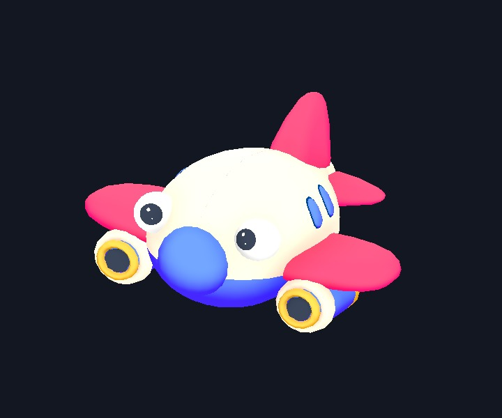<br><strong>Toy Airplane</strong><br><sub>Melee attacker · flexible wings and tail</sub></td>
    <td align="center">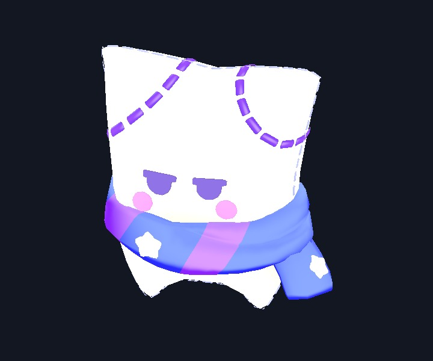<br><strong>Dozy</strong><br><sub>Pillow guard · soft landing and idle sway</sub></td>
    <td align="center">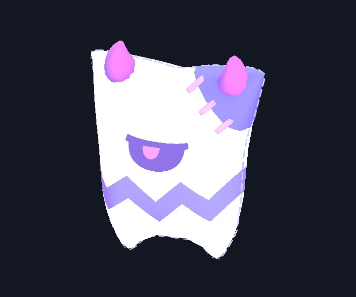<br><strong>Dizzy</strong><br><sub>Pillow guard · squash-and-stretch</sub></td>
  </tr>
</table>

- **Melee pressure:** Duck Pod, Burger UFO, and Toy Airplane approach and attack the base.
- **Ranged pressure and mobility:** Oops Chick, Roly Clown, Batloon, and Puddle Puffer combine attacks with distinct movement and hit responses.
- **Pillow guards:** Dozy and Dizzy form part of Dreamwalker's summoned defense.

The following clips show how two ranged enemies change position during combat, including the projectile and the destination.

<p align="center">
  <strong>Fire, disappear, reappear</strong><br>
  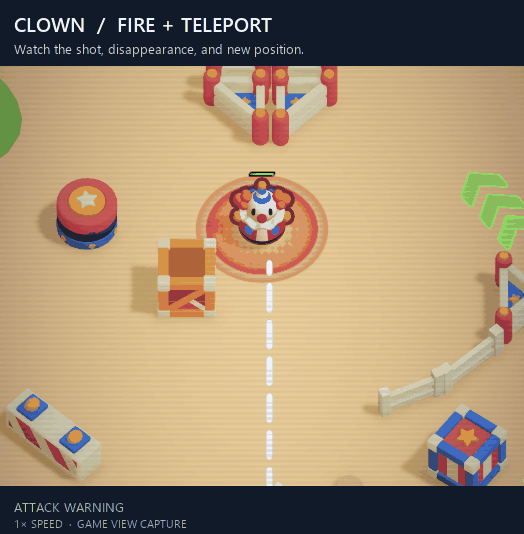<br>
  <sub><strong>Roly Clown:</strong> follow the shot, then locate the next attack position.</sub>
</p>

<p align="center">
  <strong>Fire, take off, relocate</strong><br>
  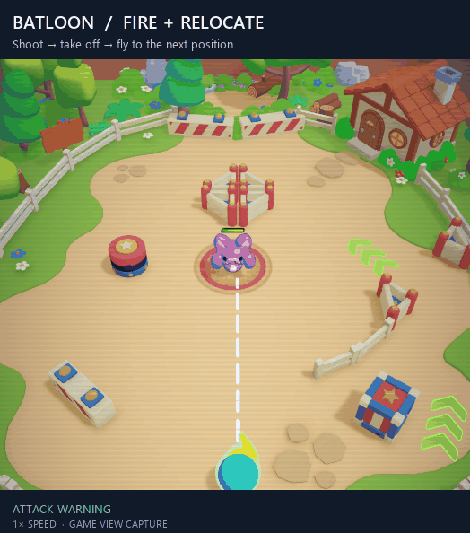<br>
  <sub><strong>Batloon:</strong> takeoff and wing motion accompany actual movement to a new position.</sub>
</p>

## Boss — Dreamwalker

A sleepwalking caster who summons pillow guards, places sleep bubbles, and attacks with musical notes and a Moon projectile. The encounter combines board hazards, supporting enemies, and an opportunity to turn his attack against him.

**Intercept the Moon with the ball → send an alarm bell back → damage and stagger Dreamwalker.** The clip follows this complete interaction, from the casting tell to the boss's reaction.

<p align="center">
  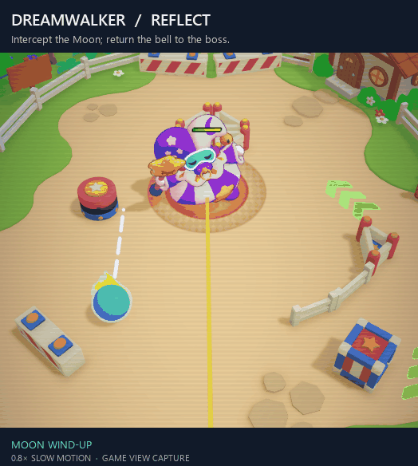
  <br><sub>Moon reflection in a controlled encounter setup · 0.8× speed</sub>
</p>

<details>
<summary><strong>Board and boss screenshots</strong></summary>
<p align="center">
  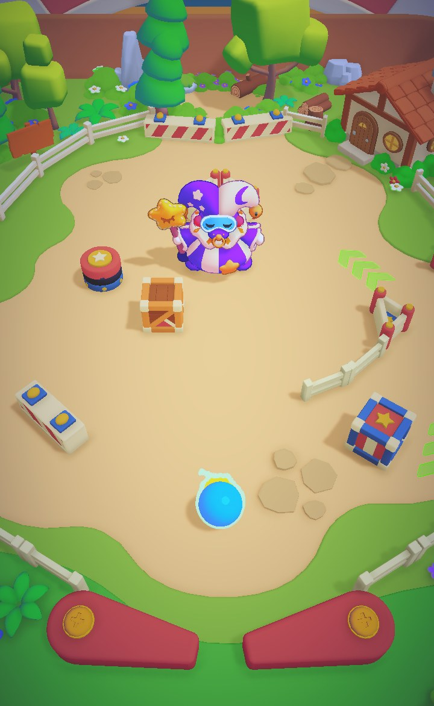
  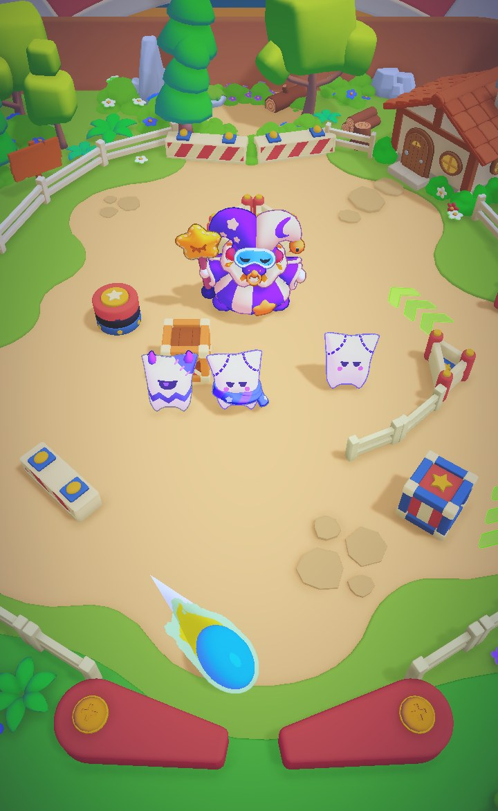
</p>
</details>

## Technical foundation

- **Custom ball simulation:** launch control, swept collision handling, surface responses, flippers, portals, and dash targeting.
- **Procedural character motion:** action timing, anticipation, recoil, and secondary motion driven by gameplay state.
- **SoftMotion:** mesh deformation with impact inputs, configurable response modules, presets, and editor previews.
- **Data-driven tuning:** ScriptableObject profiles for gameplay, enemy behavior, and encounter settings.
- **Editor workflow:** character animation previews, scene setup tools, validation checks, and performance measurement tools.

This is an actively developed prototype; gameplay, visuals, and tuning continue to evolve.

## Controls

| Input | Action |
| --- | --- |
| Drag backward from the ball, then release | Aim, charge, and launch |
| **A / D** | Left / right flipper |
| **Space** | Dash toward the nearest eligible target |
| **R** | Recall the ball to the launch point |

## Source code access

Project C — Pinball is a personal game project in active development. **The development repository remains private, and the source code, Unity project files, and original game assets are not shared publicly during development.**

This public repository contains the project overview, gameplay GIFs, character portraits, screenshots, and a commit-count snapshot. Cloning it provides these showcase materials only; it does not provide the playable Unity project or access to the private development repository.

> **Tiếng Việt:** Đây là dự án game cá nhân đang trong quá trình phát triển. Mã nguồn, project Unity và asset gốc được giữ private, không chia sẻ công khai trong giai đoạn này. Repo public dùng để giới thiệu gameplay, nhân vật, các tính năng hiện có và minh chứng quá trình phát triển.

## Development history

**252 commits** were verified on the private repository's `main` branch on **28 October 2026**.

| Snapshot field | Recorded value |
| --- | --- |
| Source repository | `lekhoa178/Project-C---Pinball` |
| Visibility | Private |
| Branch | `main` |
| Commits reachable from the recorded revision | **252** |
| Recorded revision | `4119d4202cc59050837bf2cbeffb409a4a0551c0` |
| Revision committed at | 28 October 2026, 17:40:18 (UTC+07:00) |
| Snapshot recorded at | 28 October 2026, 22:31:59 (UTC+07:00) |

[View the commit-count evidence](evidence/commit-snapshot.json)

The count was checked using GitHub's authenticated GraphQL API (`history.totalCount`) and independently cross-checked with `git rev-list --count` in the complete local clone. Both reported **252**, and the local revision matched GitHub's `main` branch.

This is the total history reachable from the recorded revision, including merge commits and commits by all authors. It is not a count of commits in this public showcase or an individual contribution total. Uncommitted work is excluded.

### Evidence and verification

The JSON records the observed GitHub response, the revision, the timestamp, and the local verification results. It contains no source files, assets, commit messages, or credentials.

Someone with access to the private repository can reproduce the recorded count with:

```sh
git rev-list --count 4119d4202cc59050837bf2cbeffb409a4a0551c0
# Expected result: 252
```

This is an owner-published snapshot, not a GitHub-signed attestation. Public visitors cannot independently inspect the underlying private history. The count is static and may increase as development continues.
